SOLAR EMBER PROFILE · DREXJGOBGT · LIVE

<h3>Full-Stack &amp; Systems Developer</h3>

Building desktop tools, web apps, analytics consoles, and automation pipelines in public.

  
  
  
  

 

✦ ───────────────────────────── ✦

## The city I built this year

  
   
  Every tower is a day; taller and brighter means more contributions.

## Momentum, made visible

  

 

<!-- STATS:START -->

| Followers | Repositories | Stars | Contributions | Active Days | Longest Streak |
|:---:|:---:|:---:|:---:|:---:|:---:|
| **4** | **15** | **4** | **119** | **34** | **3d** |

<!-- STATS:END -->

## The tools behind the signal

  

 

<b>Full Stack &amp; Ecosystem (Languages · Frameworks · Databases · Infra)</b>

 

**Languages**
 

**Frameworks &amp; Libraries**
 

**Databases &amp; Infra**
 

## Featured landmarks

  

 

<!-- PROJECTS:START -->
| [KAGE](https://github.com/drexjgobgt/KAGE) | [NusaPulse](https://github.com/drexjgobgt/NusaPulse) | [shortsgenerator](https://github.com/drexjgobgt/shortsgenerator) | [mini_crm](https://github.com/drexjgobgt/mini_crm) |
| :--- | :--- | :--- | :--- |
| Lightweight instant replay & direct MP4 capture studio for Windows.  `Rust` · ★ 0 · 1h ago | Indonesian food prices, weather, and anomaly analytics console.  `Python` · ★ 0 · 20d ago | Automated local Python pipeline for generating YouTube Shorts.  `Python` · ★ 1 · 29d ago | Web-based daily CRM built for Indonesian UMKM businesses.  `JavaScript` · ★ 1 · 1mo ago |
<!-- PROJECTS:END -->

  More shipped builds: <a href="https://simple-e-commerce-umkm.vercel.app">simple-e-commerce-umkm</a> (Live on Vercel) · <a href="https://github.com/drexjgobgt/SPK_TOPSIS">SPK_TOPSIS</a> · <a href="https://github.com/drexjgobgt/handTracker3Dvoxel">handTracker3Dvoxel</a>

 

✦ ───────────────────────────── ✦

## Make something worth noticing

  
    
  <a href="https://github.com/drexjgobgt">GitHub</a> ·
  <a href="https://discord.gg/drexxsss">Discord</a> ·
  <a href="https://instagram.com/rffsyndn">Instagram</a> ·
  <a href="mailto:rafifsyandana@proton.me">Email</a>
    
  DRexx · Solar Ember profile powered by live GitHub Actions

